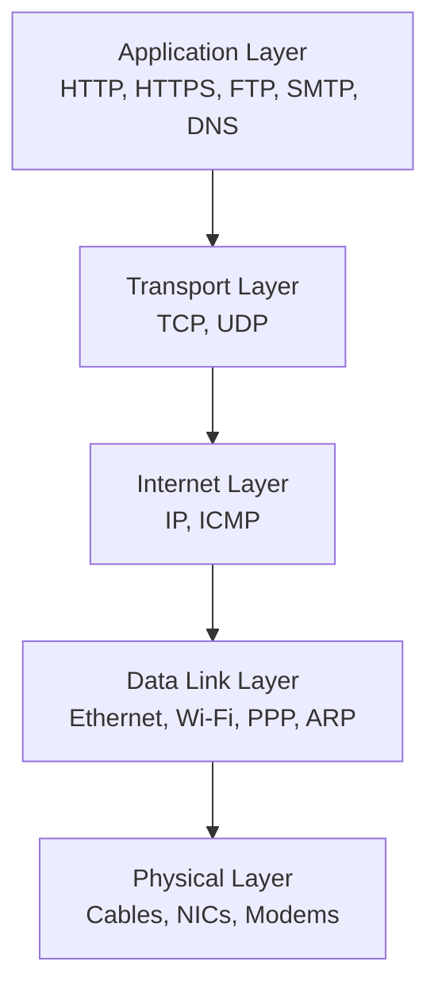

---
tags:
  - network
  - theory
---

# Computer Network

A computer network is a **system of two or more computers** that are **connected together by a transmission medium** for the **exchange of data**.

### LAN (Local Area Network)

A Local Area Network (LAN) is a network that connects computers and other devices within a **limited geographical area**, such as a home, office, or school. This allows devices to **communicate and share resources** at **high speeds**.

##### Characteristics of LAN

- Covers a **small geographical area** (e.g. one building or campus)
- Usually **owned and managed by a single organisation or individual**
- Provides **high data transfer speeds** (typically 100 Mbps to 10 Gbps or more)
- Has **low latency** because devices are **physically close together**
- Can be **wired (Ethernet) or wireless (Wi-Fi)**

##### How does a LAN work?

- Devices **connect to a network** switch (or **wireless access point** if using Wi-Fi).
- Each device has its own **IP address and MAC address**, allowing data to be delivered to the **correct destination**.

##### Advantages of LAN

- **High Speeds**
- **Low Latency**
- **Easy resource sharing**
- **More secure** since its privately managed
- **Relatively inexpensive**

##### Disadvantages of LAN

- **Limited coverage**
- Requires **network equipment** (switches, cables, routers, etc.)
- **Network failure** can affect many users

### WAN (Wide Area Network)

A Wide Area Network (WAN) is a network that **connects multiple LANs** over **large geographical areas**, such as cities, countries, or continents, using **communication links** provided by **telecommunications companies** or **Internet Service Providers (ISPs)**.

##### Characteristics of WAN

- **Covers a large geographical area**
- **Connects multiple LANs** together
- Often uses **leased lines**, **fibre optic cables**, **satellites**, or the Internet
- Usually managed by **multiple organisations or service providers**
- Generally **slower and has higher latency** than a LAN

##### Advantages of WAN

- **Connects distant locations**
- Enables **global communication**
- Support **remote work**
- **Centralised data management**

##### Disadvantages of WAN

- **Higher cost**
- **Higher latency**
- **More complex to manage**
- **More security risks** because data often travels over **public infrastructure**

### Metropolitan Area Network (MAN)

A metropolitan area network (MAN) is a network of computing devices covering a **larger geographical area** (**two or more buildings within the same town or city**) than a LAN. A MAN is typically **owned and operated by a large organisation** such as a cities, business or government body.

### Intranet

- An intranet is a **private network** built within an organisation, like a company, school, or government agency.
- Are often used to host **internal resources** like **company documents**, **employee portals**, **collaboration tools**, and **communication platforms**. Since **access is restricted**, intranets offer a **more secure environment** for sharing **sensitive information** compared to the **public internet**.

### Internet

- The internet is a **global, public network** **accessible to anyone** with an internet connection. It is a **network of networks** linked by a broad array of **electronic, wireless, and optical networking technologies**. It is essentially an **infrastructure that provides services to applications**.

### Difference in Intranet and Internet

| Feature | Intranet | Internet |
|---|---|---|
| **Scope** | **Private network within an organization** | **Public network accessible globally** |
| **Access** | **Restricted to authorized users** within the organization | **Open to anyone with an internet connection** |
| **Content** | **Internal resources relevant to the organization** (documents, portals, tools) | **Diverse content from various sources** (news, social media, entertainment) |
| **Security** | **More secure** due to **restricted access** | Less secure due to **open nature** |
| **Connection** | Can be isolated from the internet or connected with security measures | Connects devices across the globe |
| **Purpose** | **Internal communication**, collaboration, **secure resource sharing** | **Global communication**, **information sharing**, **access to online services** |


A protocol is **a set of rules and conventions** that **governs how data is transmitted and exchanged** between devices over a network.

# Network Hardware

### Nodes

Any device or computer that can **connect to a network** and **generate, process, or transfer data**.

### Network nodes

Can either be **endpoints or redistribution points**.

- Endpoints are nodes that function as a **source or destination for data transfer**.
- Redistribution nodes are **nodes that transfer data**, such as router or network switches.

### Network topologies

- the **physical or logical arrangement** of **devices (nodes) and connections (links)** in a computer network that **dictates how data flows**

### Wi-Fi

Wi-Fi is a **wireless networking technology** based on the **IEEE 802.11 family of standards** that allows devices to connect to a Local Area Network (LAN) using **radio waves instead of physical cables**.


### WLAN (Wireless Local Area Network)

A Wireless Local Area Network (WLAN) is a Local Area Network (LAN) in which devices **communicate wirelessly using Wi-Fi** (IEEE 802.11) **instead of Ethernet cables**.

A typical WLAN uses one or more **Wireless Access Points (WAPs)** to allow devices to **connect to the WLAN wirelessly**.

### Network Interface Card (NIC)

A **Network Interface Card (NIC)** is a **hardware component** that enables a device to **connect to a network** by **transmitting and receiving data**. It provides the **physical or wireless interface** between the device and the network and is assigned a **unique MAC (Media Access Control) address**.

##### Characteristics of NIC:

- Connects a device to a network
- Can be **wired (Ethernet) or wireless (Wi-Fi)**
- Has a **unique MAC address**
- Operates primarily at the **Physical Layer (Layer 1)** and **Data Link Layer (Layer 2)** of the OSI Model
- Converts data between the **computer’s internal format** and **signals suitable for transmission** over the network

# Ethernet

Ethernet is network standard that allows data to split into packets or frames which allow them to be transmitted wirelessly and physically. 

# Types of Network Devices

### Hub

- A device that **connects multiple devices** in a local network and **blindly broadcasts data to all devices** in the network.
- It operates at the `Physical Layer` (`Layer 1 of the OSI Model or the TCP/IP Model`). This is because it only **broadcasts digital signals** and **doesn’t deal with frames or packets**.

### Switch

A networking device that connects **multiple devices** within a Local Area Network (LAN) and **forwards data frame**s only to the intended destination device, based on the **destination MAC address**, using a **MAC address table.**

The switch works at the **data link layer** (2nd layer of the OSI Model or TCP/IP Model). As it only **examines the ethernet frames**. It **doesn’t rewrite any MAC addresses and IP addresses** written in ethernet frames provided to it.

### HOW DOES A SWICTH WORK?

- **Examine:** The switch examines the packet’s header to **extract the destination MAC address**.
- **Lookup:** The switch looks up its **MAC address table** to determine **which port is associated with the destination MAC address**.
- **Forward/Filter:** The switch **forwards the packet to the corresponding port** if the destination MAC address is in the table, or **floods the packet to all ports** (**except the receiving port**) if the address is not in the table.

## Router

- A router is a networking device that routes data packets **between computer networks**. 

- The router operates at the **network layer** (3rd layer of the OSI Model or TCP/IP Model). This is because a router **removes the MAC addresses** of the ethernet frames received and **examines the IP address of the packet**, before **adding on new MAC addresses** and **forwarding the new ethernet frame**.

- **Routing tables** contain the information necessary to forward a package along the **shortest/best route** to allow it to reach its destination. As soon as the packet reaches a router, the **packet header is examined** and compared with the routing table. The table supplies the router with instructions to send the packet to the **next available router**

### How A ROUTER WORKS
- It **Receives the packet** and reads its **destination IP address**.
- Uses its **routing table/routing information** to choose an **appropriate next hop or route**.
- **Forwards the packet** onto the next network towards the manufacturer's server.
- **Different packets may take different routes**.

### Hub v.s. Switch v.s. Router

|Network Device|OSI Layer|Uses|Forwards|
|---|---|---|---|
|Hub|Layer 1 (Physical)|Electrical Signals|Bits|
|Switch|Layer 2 (Data Link)|MAC Addresses|Unchanged Ethernet Frames|
|Router|Layer 3 (Network)|IP Addresses|Ethernet Frames with new MAC Addresses|

## Modem

‘Modem’ stands for **modulator-demodulator**.

A modem is a network device that **demodulates signals** on the WAN side into digital data for the local network and **modulates digital signals** from the LAN to signals to be transmitted to the WAN.

### Wireless Access Point (WAP)

A **Wireless Access Point** (WAP) is a networking device that allows **wireless devices to connect to a wired LAN** using Wi-Fi.

# IP and MAC Addresses

## IP Address

An IP (Internet Protocol) address is a **logical numerical address** assigned to a device on a network, used to **identify the device** and enable **data to be routed between different networks**.


### DHCP (Dynamic Host Configuration Protocol)

The DHCP (Dynamic Host Configuration Protocol) is the protocol that **automatically assigns IP addresses and other network settings** to devices **when they join a network**.

>[!DORA process]
>
>DHCP follows **four main steps**, commonly remembered as DORA.
>
>**Step 1:** **Discover**
>
>- The **device has no IP address yet**.
>- It **cannot send packets to a specific destination** because it **doesn’t know who the DHCP server is**.
>- So it sends a **broadcast message to all hosts in the network**. **Only DHCP servers respond**.
>
>**Step 2:** **Offer**
>
>- The DHCP server checks its **pool of available addresses**.
>- Suppose its pool is `192.168.100` to `192.168.1.200`.
>- It might reply by offering any one of the available IP addresses, for example 192.168.1.105. This is known as a **DHCP offer**.
>
>**Step 3:** **Request**
>
>- The **client responds with the IP address** that it has decided to use (it requests to use a specific IP address that has been offered). It **broadcasts the IP address** so that if multiple DHCP servers made offers, they all know **which offer was accepted**.
>
>**Step 4:** **Acknowledgement (ACK)**
>
>- The DHCP server responds with an acknowledgement, allowing the client to **configure its IP address** and start to **communicate with other hosts** in the network.
>
>- The server listens on **UDP port number 67**, and the client listens on **UDP port number 68**.

### MAC Address

A MAC (Media Access Control) address is a unique $48$-bit hexadecimal identifier assigned to a **Network Interface Card (NIC)**, allowing devices to be **identified and communicate on a Local Area Network (LAN)**.

**Example:**

```
00:1A:2B:3C:4D:5E
```

### IP v.s. MAC addresses

| IP Address | MAC Address |
|---|---|
| Logical address | Physical/Hardware address |
| **Network Layer** `(Layer 3)` | **Data Link Layer** `(Layer 2)` |
| Used for routing between networks | Used for delivery within a LAN |
| Can change | Usually fixed |
| Assigned by DHCP/admin | Assigned by manufacturer |
| Used by routers | Used by switches |

### IPv4 v.s. IPv6 v.s. MAC addresses

| Feature | MAC | IPv4 | IPv6 |
|---|---|---|---|
| **Function** | Used by network switches to direct data within the same network | Used by routers to direct data across different networks | Used by routers to direct data across different networks |
| **Length of Address** | 48 bits | **32 bits** | 128 bits |
| **Address Format** | Six groups of two **hexadecimal digits** **separated by colons** or dashes | Four denary numbers between 0 and 255 separated by dots | **Eight groups of four hexadecimal digits** **separated by colons**. Can be shortened by omitting leading zeros as well as a section of consecutive zeroes |
| **Permanent** | Yes | No | No |

### The difference between public and private IP

- Public IP addresses are **globally unique addresses** **assigned by an ISP** that are used to identify devices on the **public internet**. They are **directly routable and accessible** from anywhere online.
- Private IP addresses are from **reserved ranges** (e.g., 192.168.x.x) used to identify devices **within a local network**. They are **not routable on the public internet** and **cannot be used for direct communication online**.

# Packets

A packet is a **unit of data** at the **Network Layer** (`Layer 3`) of the OSI Model that contains a **payload and logical addressing information** (**Source and Destination IP addresses**), allowing **data to be routed between different networks**.

### Why do we need packets?

- When sending **large amounts of data**, **sending everything as one huge block is inefficient**.
- Instead, **data is broken into smaller pieces called packets**.


### Structure of an IP Packet Header

```
+---------+---------------+----------------+----------------+
| Version | Header Length | Type of Service| Total Length   |
+---------+---------------+----------------+----------------+
| Identification          | Flags | Fragment Offset         |
+-------------------------+-------+-------------------------+
| TTL     | Protocol      | Header Checksum                 |
+---------+---------------+---------------------------------+
| Source IP Address                                         |
+-----------------------------------------------------------+
| Destination IP Address                                    |
+-----------------------------------------------------------+
| Options                                                   |
+-----------------------------------------------------------+
| Data / Payload                                            |
+-----------------------------------------------------------+
```

### Packet Switching v.s. Circuit Switching

Packet Switching

- A message from one computer to another is **broken up into individual (numbered) packets** and each packet is **sent separately**.
- The **route for each packet is not determined in advance**. Routers **examine the destination IP address** of each packet and use their **routing tables** to **determine the next hop** towards the destination. Packets thus **travel by different routes**.
- The destination computer receives the packets and **use sequence numbers allow the receiver to reassemble packets in the original order.**

Circuit switching

- A **path is set up between the sender and receiver**.
- **All data follows the same path**, in order.
- The **path cannot be used by any other data**.

| Feature | Packet Switching | Circuit Switching |
|---|---|---|
| **Data Transfer** | Breaks data into **packets, sent independently** | **Dedicated path established** between sender & receiver |
| **Routing** | **Packets can take different routes** based on traffic | **Dedicated path remains fixed** for entire communication |
| **Bandwidth** | **Dynamically allocated based on traffic** | **Guaranteed bandwidth** for the communication |
| **Efficiency** | **More efficient for bursty data traffic** | **Less efficient for bursty data traffic** |
| **Cost** | Generally considered **more cost-effective** | Can be more expensive, especially for **unused bandwidth** |
| **Applications** | Ideal for data transfer (web browsing, email) | Ideal for **real-time communication** |

### Packet loss

- At times, some routers may **receive packets faster than they are able to route them** on.
- These packets are **buffered in memory** and this **introduces delays** (referred to as a '**high latency**').
- IP packets contain **ToS (Type of Service) fields** in their **headers**, which allow packets to be **classified according to priority levels**. Routers can choose whether or not to use this information to **prioritise packets**.

>[!Why is Packet Loss bad]
>For most traffic this is not an issue; it just means that the **web page takes longer to load** or a **file download takes more time** than expected. However, for other network traffic these delays may have more of an impact, particularly if you are talking over a **voice call** or playing an **online game**. If the buffering is severe, the **router may run out of memory** and **packets are simply discarded**.

### Lost Packets

- If a destination is **unreachable**, packets are sometimes sent to a default device (**default gateway**).
- A packet could theoretically get caught in a **routing loop**, being sent again and again, causing the data to infinitely cycle through devices.
- Packets come equipped with a **TTL (Time To Live)** counter, which **decreases by 1** each time the packet passes through a router. When the TTL **reaches 0**, the packet is **discarded**, **preventing infinite routing loops**.


  


### Pros and cons 
Packet switching is **more efficient** in using the **bandwidth**. Network resources are shared among multiple connections **instead of being reserved for a single connection**.

Packet switching is **more reliable and resilient**. If a network connection is congested or faulty, the pack can be routed through **alternative paths.**

Packet switching suffers from **congestion, delay and packet loss and variable performance**. In contrast, circuit switching has **guaranteed bandwidth.** 

# Network Protocols

## DNS (Domain Name System)

### What does the Domain Name System (DNS) do?

It **translates human-readable website names** (like [google.com](http://google.com/)) into **machine-friendly IP addresses** (like 192.168.1.1) so browsers can **load internet resources**. DNS uses **port 53**.


## DNS Request Process

1. The computer checks its **local DNS cache** for a previously looked-up domain name. If not found, a DNS request is made to the **Recursive DNS Server**.
2. The **Recursive DNS Server** (usually provided by the ISP) checks its local cache of recently looked-up domain names. If not found, the request is sent to the internet's **root DNS servers**.
3. The **root DNS servers** redirect the request to the correct **Top-Level Domain (TLD) server** based on the domain name.
4. The **TLD server** refers the request to the **authoritative DNS server**, which is responsible for storing the DNS records for a particular domain name.
5. The **DNS record** is then sent back to the **Recursive DNS Server**, where a local copy will be **cached for future requests** and then relayed back to the original client that made the request. Each **DNS record** has a **TTL (Time To Live)** value that determines **how long it is cached**.

## Shorter version

- When a URL is entered into a web browser:
- The browser first checks its **local DNS cache** to see if it already has the IP address stored
- If not found in cache, the browser sends a request to **Domain Name System (DNS) server with the domain name (newbank.com)**.
- The DNS server **looks up** the domain name and **returns** the corresponding IP address of the server hosting the bank’s website. 


# TCP (Transmission Control Protocol)
- The **three-way handshake** takes place **before the data transfer** to ensure that the **connection is reliable**.
  - (1) The user first sends a **synchronization packet** to the server to check that the server is ready to receive.
  - (2) The server sends an **acknowledgement back** to the user and sends its own **synchronization packet** to the user.
  - (3) The user **acknowledges the server’s synchronization packet**.
- After this, the **actual data packets are transmitted**.

# UDP (User Datagram Protocol)
- **Connectionless**, **efficient but unreliable transmission** of packets
- If any **packets are lost**, they are lost forever
- Typically used for **video streaming** which uses **VoIP (Voice over IP)** where **efficiency is required**

# HTTP v.s. HTTPS

HTTP (HyperText Transfer Protocol) is **an application-layer protocol used for communication between a client (such as a web browser) and a web server**. The client sends an **HTTP request** (e.g. GET or POST), and the server returns an **HTTP response** containing a **status code**, **headers**, and the **requested resource** (such as an HTML page, image, or JSON data).

The main difference between HTTP and HTTPS is that HTTPS uses **TLS (Transpoint Layer Security) encryption**.

# FTP (File Transfer Protocol)

- FTP (File Transfer Protocol) is an **application-layer protocol specifically designed for transferring files between a client and a server over a network.**
- While HTTP is mainly for viewing web pages, FTP is for **uploading, downloading, renaming, deleting, and managing files**.
- Uses port `21`.
- Note: Usually its **FTPS (FTP Secure)** or **SFTP (SSH File Transfer Protocol)** that are more commonly used for security.

# TCP/IP Model

The Transmission Control Protocol/Internet Protocol (TCP/IP) model **is the fundamental framework for communication across the internet.** It defines how **data is broken down, addressed, routed, and delivered between devices**. Think of it as a universal language that allows all sorts of computers and devices to **exchange information over the vast network**.



| Layer | Description | Protocols | Hardware / Software |
|---|---|---|---|
| **Physical Layer** | Handles **physical transmission of data packets** over the **network medium** cables, wires, or wireless signals. | Ethernet | Network cables, Wireless adapters, Network Interface Cards (NICs), Modems |
| **Data Link Layer** | **Packages the data into frames** and ensures **error-free transmission** between devices on the **same network segment**. | Ethernet, Wi-Fi, PPP (Point-to-Point Protocol), ARP (Address Resolution Protocol) | Network Interface Cards (NICs), Switches |
| **Internet Layer** | **Routes data packets across different networks**, determining the **best path to reach the destination device**. | IP (Internet Protocol), ICMP (Internet Control Message Protocol) | Routers |
| **Transport Layer** | Manages **reliable data transfer between applications**. | TCP (Transmission Control Protocol), UDP (User Datagram Protocol) | Not directly associated with specific hardware, but relies on the functionality of the Network Access Layer |
| **Application Layer** | Provides **services directly to applications** like web browsing, email, and file transfer. | HTTP (Hypertext Transfer Protocol), HTTPS (Secure Hypertext Transfer Protocol), FTP (File Transfer Protocol), SMTP (Simple Mail Transfer Protocol), DNS (Domain Name System) | Web browsers, Email clients, FTP clients, Operating Systems (for application support) |


| Protocol | Layer | Full Name and Purpose |
|---|---|---|
| SMTP | Application | Simple Mail Transfer Protocol. Used to **send an email to an email server**. The server returns a code indicating whether or not the email could be delivered. |
| IMAP | Application | Internet Message Access Protocol. Used to **synchronise a client email account** with an account on a mail server. The server returns new emails (if there are any) and deletes any emails that were deleted locally on the client application. This allows a user to **use multiple devices to access their email account**. |
| IP | Network (Internet) | Internet Protocol. Creates a new packet (imagine putting the packet from the transport layer into a new envelope). Adds the **source and destination IP addresses** to allow the packet to be delivered. These are the packets that are **routed across the internet**. |
| Ethernet and Wi-Fi protocols | Link (Data Link) | **Encapsulates the data** from the previous layer into frames (another kind of packet) with a **source and destination MAC address**, and **manages multiple transmissions** on the media. |

# Client-Server Processes


### Client-Server Architecture 
  - There is an **always-on host** (server) which **services requests** from other hosts (clients). 
  - The server has a **fixed, well known IP address**. 
  - The server is usually hosted on a **data center** to handle a **large number of requests**. 
  - The service providers must pay **recurring interconnection and bandwidth costs**. 
### P2P Architecture 
  - **Minimal or no reliance on data centers**. 
  - Uses **processing power of both host computers**. 
### Hybrid Architecture 
  - In some apps, servers track IP addresses but **user-user messages are P2P**. 
  - This has the **scalability and cost effectiveness** of P2P while remaining **secure and reliable**. 
### Benefits of client-server architecture
- **Easier data management** as files are stored in one **central location**, making **organizing and maintaining** is easier.
- Better **data consistency**, the same shared copy of data is accessed by the user, reducing duplicate and outdated versions.
- Access permission can be **managed centrally**, providing **better security** for shared data.

### Disadvantages of client-server architecture
- **Purchasing and maintaining a dedicated server** and server operating system is more expensive than a peer-to-peer network.
-  P2P **low latency**: direct communication reduces delays between devices
