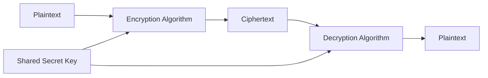
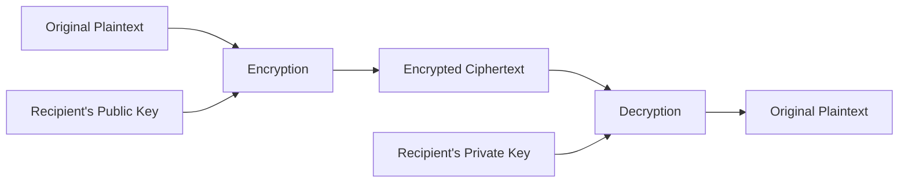
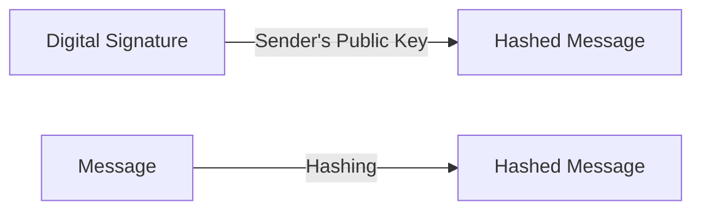

---
tags:
  - network
  - security
---

## What is Network Security?

Network Security → The shield that **protects the CIA of information and resources** in a network.

## CIA Triad

| Principle | Description |
|---|---|
| Confidentiality | Ensuring **only authorized users can access sensitive information** within a network using **encryption and access controls**. |
| Integrity | Ensuring data within a network is **accurate and has not been tampered with** using **intrusion detection systems**. |
| Availability | Ensures that **authorized users can access the information and resources** they need **whenever they require them** using **firewalls and network redundancy strategies**. |

Original wording preserved, with key concepts highlighted.

# Malmares

## Social Engineering Attacks

### Definition

Malware → Software that is specifically designed to disrupt, damage or gain unauthorized access to a computer system

A social engineering attack is a type of attack that uses **deception and trickery** to **convince unsuspecting users** to **provide sensitive data** or to **violate security guidelines**.

## Types of Malware and Cybersecurity Threats

| Name | Description |
|---|---|
| Ransomware | **Blocks access to a computer system** until a **ransom is paid** |
| Scareware | **Frightens victims** into **providing financial information or downloading viruses** |
| Spyware | **Secretly collects personal information** about users and **sends it to attacker** |
| Adware | **Pushes unwanted advertisements** at users |
| Fileless Malware | Operates in **computer’s memory**, **hiding in a trusted application or tool** |
| Cookies | **Small piece of data on websites** that **stores users’ personal information** |
| Pharming | **Intercepts requests** going to a website and **redirects it to a fake website** |
| Phishing | Using **fake emails and websites** that **appear to be from reputable companies** |
| Spamming | **Mass distribution of unwanted messages** to emails gained from **mailing lists** |
| Trojan Horse | **Pretends to be a harmless file or useful application** **until run** |
| Virus | **Attaches itself to a harmless program** and **modifies it**, and **spreads to other programs** when the **infected program is run** |
| Worm | **Runs automatically** and tries to **spread copies of itself across a network**, **consuming bandwidth and harming the host server** |

### The difference between a Trojan horse and a worm

Trojan: **Masquerades as legitimate software** and **tricks users to execute it**, **does not replicate itself**
Worm: **Self-replicating**, **spreads autonomously through networks**

# Firewalls

Firewall **monitors all incoming and outgoing network traffic** based on a **set of security rules** to **prevent unauthorized access** from entering a private network.

### Limitations:

Hackers can **bypass firewall** by inserting **malicious attacks inside legitimate programs**, for example, emails
Firewall **cannot protect against internal attacks**, for example, virus in one computer in the network
The setting of firewall may **block some legitimate programs**

| Functionality | Description |
|---|---|
| Traffic Control | **All communication must pass through the firewall**. Using a single firewall helps ensure this, but bigger organizations may **enforce multiple layers** |
| Authorized Traffic | **Only authorized traffic will be allowed to pass**, and the **rest are blocked** |
| Maintaining Security | While connected to the network itself the firewall is meant to be **resistant to attacks** |

# Denial of Service (DoS)

- **botnet** is a network of **malware infected computers** that are **remotely controlled** to **carry out** coordinated attacks. 
- DOS attacks the network traffic by sending **massive request** to **exhaust server resources and bandwidth**, and hence **disables the server** from responding to legitimate requests.

# Intrusion Detection System and Intrusion Prevention System

### IPS

An Intrusion Prevention System (IPS) is a security system that **monitors network traffic** for **suspicious or malicious activity** and **automatically takes action** to **prevent or stop detected attacks**. It may take actions such as **blocking the malicious traffic**.

- **Monitors network activity** continuously in real-time and compares activity against **known attack signatures / patterns** to identify attacks or intrusions.
- **Automatically blocks or prevents detected threats** by dropping malicious packets, blocking suspicious IP addresses or terminating malicious connections.
- **Generates alerts and keeps logs** of suspicious activities and actions taken, providing an **audit trail** for further analysis and investigation.

### IDS

An Intrusion Detection System (IDS) is a security system that **monitors network traffic or computer systems** for **suspicious or malicious activity** and **alerts an administrator** when a **potential intrusion** is detected.

- **Monitors** network activity continuously in real-time and compares activity against known attack signatures / patterns to identify attacks or intrusions.
- Generates **alerts to the security** admin when suspicious activity or threat is detected.
- Keeps **a log of activities**, **creating a detailed audit trail** for **further analysis and investigation**.

IDS systems are broadly classified as either **signature-based systems** or **anomaly-based systems.**

- **Signature Based IDS**
    - Requires **previous knowledge of attacks** to generate **accurate signatures**
    - **Blind to new, undocumented attacks**
    - Can produce **false alarms** even if a signature is matched
    - **Every packet** must be compared with an **extensive collection of signatures**
    - Can become **overwhelmed** and **fail to detect many malicious packets**

- **Anomaly Based IDS**
    - Creates a **traffic profile** based on **normal operation**
    - Detects **statistically unusual packet streams** (e.g., high percentage of
    - **ICMP packets**, exponential growth in **port scans and ping sweeps**)
    - Can **detect new, undocumented attacks**
    - Challenging to **distinguish between normal and unusual traffic**
    - Most IDS deployments are **primarily signature-based**, with some including **anomaly-based features**

- **HOW IDS WORKS**
    - Network is divided into **high-security region and DMZ**
    - High-security region protected by **packet filter and application gateway**
    - DMZ includes **public web server and DNS server**, protected by **packet filter**
    - **IDS sensors monitor both regions**
    - IDS performs **deep packet inspection** and **signature comparison**
    - Placing IDS **sensors downstream** **reduces traffic load per sensor**
    - Signature-based IDS uses a **database of attack signatures**
    - Signatures are created by **network security engineers** and can be **customized**
    - IDS **inspects each packet** and **generates alerts for matches**
    - **Alerts are sent to administrators, management systems, or logged**

# Secure access method

### Encryption

Encryption is a process that uses an **algorithm and a key** to code a message written in **plain text into ciphertext**, which is **transmitted to the recipient**.

Decryption is **decoding the ciphertext back into the original plain text** using a **decryption algorithm and a key**.

##### Purpose

- Encryption is often used to **protect data from unauthorised access** by allowing **only authorised users** to have the **secret key**.
- It can also be **used in combination with file permissions** so that an unauthorised user who is able to **bypass file permissions** would still be **unable to use the accessed data** without knowing the **secret key**.

##### Symmetric key encryption

- In symmetric key encryption, there is **just one key**. This key is a **secret shared by the sender and the receiver** of a message.

- The sender uses the **encryption algorithm together with the key** to encrypt some plaintext. The receiver **decrypts the ciphertext using the same key**
- The issue with symmetric key encryption is **delivery of the secret key**. The sender needs the key to encrypt but it is **difficult to securely deliver the key** to the receiver to allow decryption

###### Example

- Examples of old symmetric key cryptography are **Caesar cipher**, **monoalphabetic cipher**, **polyalphabetic encryption**.
- Modern symmetric key cryptography is categorised into two broad areas - **stream ciphers and block ciphers**. The latter typically, uses a technique called **Cipher Block Chaining (CBC)**.

##### Asymmetric encryption

- Asymmetric encryption, also known as **public-key encryption**, is a type of encryption that uses a **pair of keys** to **encrypt and decrypt data**.

- The pair of keys includes a **public key**, which can be **shared with anyone**, and a **private key**, which is **kept secret by the owner**.
    - allows for **secure communication** between two parties **without the need for both parties to have the same secret key**.

##### Advantage of asymmetric encryption over symmetric encryption

- It **eliminates the need to exchange secret keys**, which can be a **challenging process**, especially when communicating with multiple parties.
    - If asymmetric encryption is to be used, the process is initiated by someone in possession of two keys. One of these is a **public key**, **which is sent to anyone** who is going to partake in an encrypted communication. The other is a **secret private key**, which is **never sent to anyone**. Having a means of **secure transmission of a secret key is no longer an issue**.

### Example

- Examples of asymmetric encryption algorithms include **Rivest-Shamir-Adleman (RSA)**, **Diffie-Hellman**, and **Elliptic Curve Cryptography (ECC)**.

# Digital signature

- It is a **cryptographic technique** to indicate the **owner or creator of a resource** or to signify **one’s agreement with a document’s content** in a digital world.

- the message was created by the known sender / the message is not altered in transit
  
##### How it works
- Message is **hashed** and encrypted with **sender's private key**.
- This forms the **digital signature**.
- **Original message** is sent with the **digital signature**.
- Receiver would **decrypt the digital signature** with **sender's public key** to obtain the **hashed message**
- The **original message is hashed** and **compared with the hash message** in step 3.
- If the **two are identical**, the receiver can be certain the message **did come from the sender**, and hence the message is **authenticated**.

###### Sender:

###### Receiver:

### digital certificate

Digital Certificates are issued by a Certificate Authority (CA) to **certify the binding** between the **public key** and the **sender’s identity**.

1. The sender provides their **public key** to a **Certificate Authority (CA)** and applies for a digital certificate.

2. The CA **verifies the sender's identity** and issues a **digital certificate** containing the sender's public key and identity information. The CA **digitally signs the certificate using its private key**.

3. The sender creates a **hash of the message** using a hashing algorithm and **encrypts the hash using their private key** to generate a digital signature.

4. The sender sends the **message, digital signature and digital certificate** to the receiver.

5. The receiver uses the **CA's public key to verify the digital certificate**, ensuring that it is authentic and has not been tampered with.

6. The receiver retrieves the **sender's public key** from the verified digital certificate and uses it to **verify the digital signature and recover the original hash value**.

7. The receiver independently **generates a hash of the received message** using the same hashing algorithm.

8. The receiver **compares both hash values**. If they match, it verifies the **message's integrity and the sender's authenticity**.

# Authentication

- End-point authentication is the process of **one entity proving its identity to another entity** **over a computer network**, for example, a user proving its identity to an e-mail server.
    - For example, a user proving its identity to an e-mail server. A concrete example is a user **authenticating him or herself to an e-mail server**.

- Often, network elements such as **routers and client/server processes** must **authenticate each other**.
    - Here, authentication must be done solely on the basis of **messages and data exchanged** as part of an **authentication protocol**.
    - Typically, an authentication protocol would run **before the two communicating parties run some other protocol**.
    - The authentication protocol first **establishes the identities of the parties** to each other’s satisfaction; **only after authentication** do the parties get down to the work at hand.

>[!Common ways of authentication include:]
>- **passwords**
>- **biometrics**, for example: **fingerprints, facial recognition, iris scans**
>- **token values**, such as from a **physical device, a mobile phone or a software application**

- Some applications use **two-factor authentication (2FA)**, which uses **two different ways of authentication** for **better security**

### Biometrics authentication

Biometric Authentication Preferred Because:

1. **Unique physiological traits**
2. **Cannot be lost/stolen like tokens**
3. **Harder to replicate than token codes**

   OR

   Security Tokens Preferred Because:

4. **Not affected by physical changes**
5. **Easier to revoke/reissue**
6. **No biometric data storage risks**

   (Accept either position with valid reasoning)

### How hash protects passwords from leaking

Since a **hash is irreversible**, it is **impossible to recover the original password** from the hashed form. This ensures that even if the server’s **database is compromised**, it is **not possible to recover the list of passwords**.

When a user logs in, the **password entered by the user is hashed** and this is **compared to the hashed password stored under the user’s name** in the database. If they **do not match**, then the user has logged in with an **incorrect password** and will be prompted to retry.
