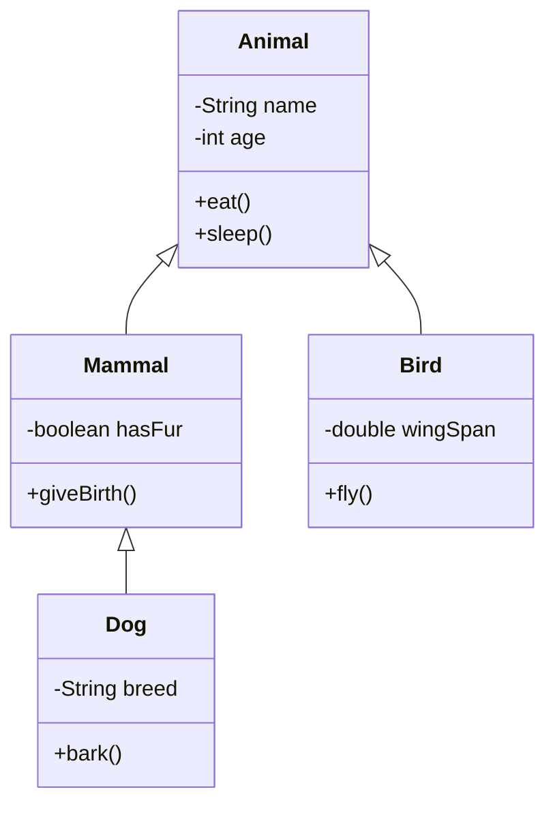

---
tags:
  - oop
  - theory
---
# Procedure v.s. OOP

### Procedure: Writing programs made of functions that perform specific tasks 
- **Simpler implementation**: Uses loops and straightforward control flow without requiring classes and objects.
- **Less code overhead**: Avoids additional class definitions, constructors and methods, reducing boilerplate code.
- **Easier debugging**: Straightforward execution flow makes errors easier to trace and identify.
- **Lower resource overhead**: May require less memory and processing time by avoiding unnecessary object creation.

### Object-Oriented Programming: focused on creating objects

- **Encapsulation**: By making attributes such as Top and StackArray private, the class prevents direct external access to the internal data. User interacts with the stack only through public methods (e.g. push, pop). This prevents accidental errors which could corrupt the integrity of the stack.

- **Reusability**: Once the stack class is created, it can be easily reused without rewriting the code. Multiple stacks can be instantiated from the same class, each maintaining its own independent data.

# OOP-General Terminologies

|Term|Definition|
|---|---|
|**Class**|Blueprint for creating objects.Defines attributes (data) and methods (behavior).|
|**Object**|An instance of a class.Represents a real-world entity with state (attributes) and behavior (methods).|
|**Abstract Data Type (ADT)**|A conceptual model that defines a set of operations and behaviours for a data structure, without specifying how these operations are implemented or how data is organised in memory|
|**Constructor**|A constructor is a method that is automatically called when an object is instantiated. It is often used to initialise data members, making dynamic memory allocation requests, opening files or communication sockets|
|**Destructor**|A destructor is a method that is invoked when the object is going to be destroyed. It is often used to end the existence of an object gracefully, by closing open files, sockets, or GUI components, as well as de-allocate dynamically allocated memory to prevent memory leakage.|
|**Class methods**|These methods can only be called through instances of a class or a subclass, which are concerned with the manipulation of class variables, and do not require the existence of any instance.|
|**Message v.s. Methods**|Method performs an activity enabling objects of a class to be manipulated. Messages are communication between objects. One object can call a public member function of another, and supply data as an argument to the function.|
|**Virtual method**|a concrete super-class method (common interface for subclass) that can be replaced ain sub-class with a new implementation.|

# Class Diagram

 "-" -> private.
"+" -> public.

# 4 Pillars of OOP

### Encapsulation

- **Definition**: Bundling **data (attributes) and methods (functions)** into a **single unit (class)**, while **restricting direct access** to internal data.
- **Purpose**: Provides **controlled access via public methods (getters/setters)**, reducing **accidental errors** and preventing **inconsistent states**.

### Abstraction

- **Definition**: **Hiding complex implementation details** and exposing only the **essential features**, focusing on **what an object does rather than how it does it**.
- **Purpose**: Promotes **modularity** and reduces **dependency on implementation details**.

### Inheritance

- **Definition**: Mechanism for **creating new classes (child) from existing ones (parent)**, allowing child classes to **reuse and extend** parent attributes and methods.
- **Purpose**: Reduces **code duplication** and promotes **reusability, specialization and extendability**.

### Polymorphism

- **Definition**: The ability of **objects of different types** to **behave in different ways** when the **same message is applied to them**.
- **Purpose**: Allows the **same code to be used with different types**, reducing **complexity** through **one interface, multiple behaviors**.

